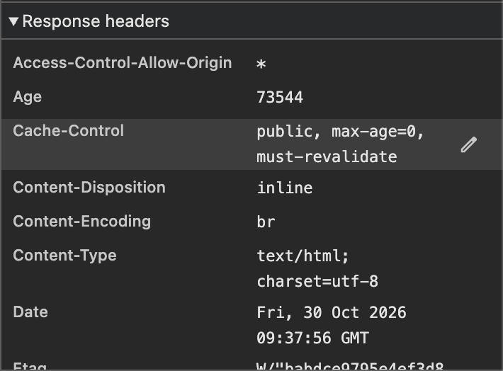
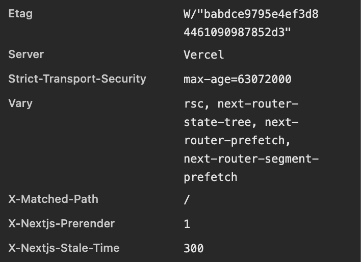
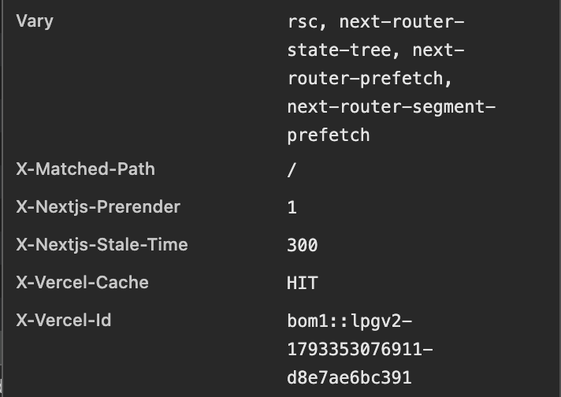

# Backend Technical Audit: cynbit.in

**Prepared by:** Kunal Mathur, for the Cynbit Backend Developer Intern assessment
**Date of review:** Fri 30 Oct 2026
**Scope:** the public homepage `https://www.cynbit.in/` and the requests the browser makes when it loads

## 1. Method (passive only)

- Chrome DevTools in an Incognito window with no extensions, one normal page load with the cache disabled.
- Network tab: response headers of the main document, and the list of requests the page makes by itself.
- Lighthouse (mobile): Performance, Accessibility, Best Practices and SEO.
- **Not done:** no scanning, no fuzzing, no load testing, no changing IDs or URLs, no testing of the candidate portal or any login. I only looked at what any visitor's browser receives.

## 2. Architecture as observed

| Layer | Evidence |
|---|---|
| Framework | Next.js App Router: `_rsc=` requests, `webpack-*.js` and `main-app-*.js` chunks, `X-Matched-Path: /`, `X-Nextjs-Prerender: 1`, `Vary: rsc, next-router-*` |
| Hosting / edge | `Server: Vercel`, `X-Vercel-Id: bom1::...` (Mumbai edge), `X-Vercel-Cache: HIT` |
| Rendering | Home page is prerendered (static) and served from the edge cache |
| Third parties | Google Analytics 4 (`js?id=G-...` plus a `collect` call returning 204), Google Fonts (Material Symbols stylesheet) |
| Navigation | The home page prefetches data for about 9 other routes (story, team, careers, impact, services, products, bitelevate, contact, case-studies) |
| Size | 44–45 requests on a fresh load, about 1.7 MB transferred (1,683 KiB per Lighthouse) |

## 3. What is already good

- **Brotli compression** (`Content-Encoding: br`).
- **HTTPS enforced** with `Strict-Transport-Security: max-age=63072000` (2 years).
- **Caching works:** `ETag`, edge cache hits, conditional requests returning 304.
- **Low main-thread blocking:** Total Blocking Time 30 ms, Cumulative Layout Shift 0.013.
- **Lighthouse:** Best Practices 100, SEO 100, Accessibility 90.
- **Error handling:** a branded 404 page ("Node Not Found") with recovery buttons, and separate `error`, `not-found` and `global-error` route chunks, which points to proper error boundaries. See 4b.

## 4. Findings

| # | Area | Observation | Severity |
|---|---|---|---|
| 1 | Security headers | No `Content-Security-Policy` | Medium |
| 2 | Security headers | No clickjacking protection (`X-Frame-Options` or CSP `frame-ancestors`) | Low–Medium |
| 3 | Security headers | No `X-Content-Type-Options: nosniff` | Low |
| 4 | Security headers | No `Referrer-Policy` or `Permissions-Policy` | Low |
| 5 | Security headers | HSTS has no `includeSubDomains` or `preload` | Info |
| 6 | CORS | `Access-Control-Allow-Origin: *` on the HTML document | Info |
| 7 | Performance | Largest Contentful Paint **4.9 s** (rated poor); Speed Index 4.6 s | Medium |
| 8 | Performance | Render-blocking requests (estimated saving 1,100 ms) | Medium |
| 9 | Performance | About 119 KiB of unused JavaScript, 2.4 s main-thread work, 4 long tasks, 11 KiB legacy JavaScript | Low–Medium |
| 10 | Performance | The home page prefetches about 9 routes up front | Info |
| 11 | Accessibility | List markup problems: `<li>` outside `<ul>`/`<ol>`, and lists containing non-`<li>` elements | Low |
| 12 | API / data format | Page data is served as React Server Component payloads (`text/x-component`) from `?_rsc=` URLs, not a documented JSON API (observation, see 4a) | Info |
| 13 | Hosting region | `X-Vercel-Id: bom1::iad1::...` suggests the edge is in Mumbai but the origin or compute region is `iad1` (US East) | Low–Medium (to verify) |
| 14 | Data handling | A Google Analytics call (`collect`, 204) fires on page load, and no consent notice was visible in a fresh Incognito session | Low |

**Evidence:** `assets/response-headers-1.png`, `-2.png` and `-3.png` show the full response header list of the main document. The three headers screenshots are alphabetical, and none of the headers in findings 1–4 appear in them.





### Notes on specific findings

- **#6:** a wildcard CORS header on a public HTML page is common on static hosting and is low risk. It should never be present on authenticated or API responses.
- **#8:** I did not expand the Lighthouse list, so I can't say exactly which files block rendering. Candidates visible in the Network list are the CSS chunks and the Google Fonts stylesheet (`css2?family=Material+Symbols...`).
- **#10:** prefetching makes clicks feel instant but adds requests on first load. Whether that trade-off is right depends on how many visitors click through.

## 4a. API structure and payloads (observed)

I opened the Fetch/XHR requests the page makes by itself and inspected one in detail, `GET /contact?_rsc=...`.

| Property | Observation |
|---|---|
| Method / URL pattern | `GET /<route>?_rsc=<hash>`, one per route the page prefetches (story, team, careers, impact, services, products, bitelevate, contact, case-studies) |
| Response format | `Content-Type: text/x-component`, the Next.js React Server Components stream, not JSON |
| Size | `/contact` about 2.6 kB; most others under 0.5 kB |
| Compression | `Content-Encoding: br` |
| Caching | `Cache-Control: public, max-age=0, must-revalidate`, `X-Vercel-Cache: HIT`, `Age: 17384` s, `X-Nextjs-Prerender: 1`, `X-Nextjs-Stale-Time: 300` |
| Cache correctness | `Vary: rsc, next-router-state-tree, next-router-prefetch, next-router-segment-prefetch` keeps HTML and RSC responses from mixing in the cache, which is correct |
| Routing | `X-Matched-Path: /contact.rsc` |

**Takeaways**
- The public site has no custom REST/JSON API. Data moves as prerendered RSC payloads, cached at the edge. That is a sound, low-risk setup for a mostly static marketing site.
- Any forms or the candidate portal presumably call separate endpoints. Those weren't observed and weren't tested.
- **Analytics call (`collect`):** the Google Analytics beacon returns 204 with no body, and its response headers (`Server: Golfe2`, Google's own CSP report-only and Report-To headers) belong to Google, not Cynbit. It fires on page load. If the site has no consent notice before that call, the team may want to load analytics only after consent. I am not a lawyer, so this is a point to check, not a legal conclusion.
- **Region (finding 13):** the second token in `X-Vercel-Id` normally names the region where the work happened. `iad1` is Vercel's default region in the US. If Cynbit's users are mainly in India, serverless or cache-refill work in `iad1` adds a long round trip on cache misses.

## 4b. Error handling (observed)

| Test | Result |
|---|---|
| Visit a path that does not exist (`/this-page-does-not-exist`, on `www` and on the bare domain) | A custom, branded 404 page. It shows "ERROR CODE: 404", the headline "Node Not Found.", a short explanation, and two buttons ("Return to Base", "Report Broken Node") |
| What the error page reveals | No stack trace, file path, framework error or server detail was visible to a visitor |
| Error boundaries | The page loads dedicated `error-*.js`, `not-found-*.js` and `global-error-*.js` chunks, so the Next.js error boundaries (`error.js`, `not-found.js`, `global-error.js`) appear to be in place |

**Takeaway:** error handling on the public site looks well done. The 404 page is friendly, leaks nothing, and gives the visitor a way back.

**Suggestions**
- Confirm the response status really is `404`, not `200` with a 404-looking page. A "soft 404" confuses search engines. In Next.js, `not-found.js` returns a real 404 by default.
- Add `robots: { index: false }` to the not-found page metadata.
- Add server-side error logging and alerting (for example Sentry or Vercel's logs) so errors that visitors hit are seen by the team, and so "Report Broken Node" reports go somewhere monitored.

```js
// app/not-found.js
export const metadata = { title: 'Page not found', robots: { index: false } };
```

## 5. Recommended improvements

### 5.1 Security headers (`next.config.js`)

```js
// next.config.js
const securityHeaders = [
  { key: 'X-Content-Type-Options', value: 'nosniff' },
  { key: 'X-Frame-Options', value: 'DENY' },
  { key: 'Referrer-Policy', value: 'strict-origin-when-cross-origin' },
  { key: 'Permissions-Policy', value: 'camera=(), microphone=(), geolocation=()' },
  { key: 'Strict-Transport-Security', value: 'max-age=63072000; includeSubDomains; preload' },
  // Start in report-only mode so Google Analytics and Fonts don't break:
  {
    key: 'Content-Security-Policy-Report-Only',
    value: [
      "default-src 'self'",
      "script-src 'self' 'unsafe-inline' https://www.googletagmanager.com",
      "style-src 'self' 'unsafe-inline' https://fonts.googleapis.com",
      "font-src 'self' https://fonts.gstatic.com",
      "img-src 'self' data: https:",
      "connect-src 'self' https://*.google-analytics.com https://www.googletagmanager.com",
      "frame-ancestors 'none'",
    ].join('; '),
  },
];

module.exports = {
  async headers() {
    return [{ source: '/(.*)', headers: securityHeaders }];
  },
};
```

Roll out in this order: report-only first, review the violations, then switch to enforcing `Content-Security-Policy`. Add `preload` to HSTS only once every subdomain is HTTPS.

### 5.2 Fonts: remove the render-blocking stylesheet

```js
// app/layout.js
import { Inter } from 'next/font/google';
const inter = Inter({ subsets: ['latin'], display: 'swap' });

export default function RootLayout({ children }) {
  return <html lang="en" className={inter.className}><body>{children}</body></html>;
}
```

`next/font` self-hosts the font and removes the extra request to Google. Use the same approach for Material Symbols, or ship only the icons the site needs as inline SVG.

### 5.3 Cut unused JavaScript

```js
// load heavy, below-the-fold components only when needed
import dynamic from 'next/dynamic';
const Testimonials = dynamic(() => import('./Testimonials'), { ssr: false });
```

Also check the `browserslist` setting. Targeting modern browsers removes the legacy-JavaScript transforms (about 11 KiB).

### 5.4 Prefetching

```jsx
<Link href="/impact" prefetch={false}>Impact</Link>
```

Keep prefetching on the two or three most-visited routes and turn it off for the rest.

### 5.5 Accessibility

Make list markup valid: wrap every `<li>` in a `<ul>` or `<ol>`, and put only `<li>` (and script or template elements) directly inside a list.

### 5.6 Pin the compute region near users (`vercel.json`)

```json
{
  "regions": ["bom1"]
}
```

This runs functions in Mumbai instead of the US default. Verify first by checking the project's region in the Vercel dashboard.

### 5.7 Backend hardening for the parts I could not test

I only looked at public pages, so I did not see Cynbit's contact form, application form or candidate portal. These are things I would check on any backend like it, written as suggestions and not as findings.

| Area | What to check | Why |
|---|---|---|
| Input validation | Every field is validated on the **server** (type, length, format), not only in the browser | The browser can be bypassed |
| Rate limiting | Form and login endpoints return `429` with `Retry-After` after a few requests per minute per client | Stops spam and abuse |
| Error responses | One consistent JSON shape (`error`, `requestId`) and correct status codes (400, 422, 429), with no stack traces | Easier for clients, and no internal details leak |
| Logging | A request id on every log line, structured (JSON) logs, and alerts on error spikes | Lets the team trace a failed submission |
| Database access | Parameterised queries or an ORM, never SQL built from strings | Prevents SQL injection |
| Caching | Static pages are prerendered and cached (already the case). For content that changes, use on-demand revalidation such as `revalidatePath` | Fresh content without a rebuild |
| Duplicate submissions | An idempotency key or a disabled submit button after the first click | Avoids double applications |
| Candidate links | The portal link in an application email identifies the candidate by an ID in the URL. If that link alone grants access, consider expiring links or requiring a sign-in | A leaked or forwarded link would expose that candidate's page |

An example handler with validation, a rate limit, structured errors and request-id logging is in `fixes/contact-route.example.js`. It is an illustration and is not taken from Cynbit's code.

## 6. Priorities

1. Add the four small security headers (#2, #3, #4, #5). It takes minutes and has no side effects.
2. Fix Largest Contentful Paint (#7, #8): fonts and render-blocking CSS.
3. Roll out a Content-Security-Policy in report-only mode (#1).
4. Reduce unused JavaScript (#9) and review prefetching (#10).
5. Fix the list markup (#11).
6. Confirm and, if needed, change the compute region (#13) and the analytics consent flow (#14).
7. Check validation, rate limiting, logging and link handling on the forms and the portal (5.7).

## 7. Repository contents and how to reproduce

```
README.md                  this report
assets/                    header screenshots used as evidence
fixes/next.config.js       security headers (section 5.1)
fixes/not-found.js         404 metadata (section 4b)
fixes/vercel.json          compute region (section 5.6)
fixes/contact-route.example.js   example form handler (section 5.7)
tools/check-headers.sh     passive header checker (one HEAD request)
tools/sample-headers.txt   headers observed on the main document, transcribed from my screenshots
```

**Reproduce the header check (passive, one request):**

```bash
bash tools/check-headers.sh https://www.cynbit.in/
bash tools/check-headers.sh --file tools/sample-headers.txt   # offline, uses the saved headers
```

**Reproduce the rest in Chrome:** open an Incognito window, press F12, tick Disable cache in the Network tab, reload, and inspect the first request's response headers. Run Lighthouse in mobile mode from the Lighthouse tab. Filter the Network tab by Fetch/XHR to see the `_rsc` requests.

## 8. Limitations

- One page load, one network, one device profile. Lighthouse scores vary between runs.
- Authentication was **not** assessed. The candidate portal, login and any API behind authentication were not tested, because only passive testing of public behaviour was allowed.
- One page load of the bare domain (`cynbit.in`, without `www`) timed out once from my network. I could not reproduce it, and later loads of both versions worked, so I treat it as a network blip and not a finding.
- I did not capture the HTTP status code of the 404 page, so I list its confirmation as a suggestion in 4b.
- This is an observation-based review. I did not see Cynbit's source code, so the recommendations are suggestions to validate, not confirmed defects.
